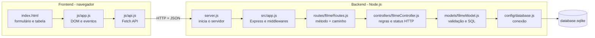

# 🎬 CineLog — Catálogo de Filmes e Séries

Projeto prático da **Quarta Etapa** (Desenvolvimento do CRUD) da disciplina de Programação para Internet.

O CineLog é um catálogo pessoal onde o usuário registra filmes e séries que **já assistiu** ou que
**quer assistir**, com gênero, ano de lançamento, nota e um comentário/sinopse. Implementa um CRUD
completo (Criar, Ler, Atualizar e Excluir) com **backend em Node.js + Express + SQLite** e
**frontend em HTML, CSS e JavaScript puro**.

**Equipe:** _preencher com os nomes da equipe dos seminários_

## Funcionalidades

- Cadastrar, listar, editar e excluir filmes e séries.
- Marcar um título como **assistido** e dar uma **nota de 0 a 10** (só é possível dar nota ao que já foi assistido).
- Buscar pelo título e filtrar por gênero e situação (assistido / para assistir).
- Painel de resumo: total no catálogo, assistidos, pendentes e nota média.

## Estrutura

```
trabalho-progint-saulo-roberto/
├── backend/
│   ├── src/
│   │   ├── config/
│   │   │   └── database.js        # Conexão com o SQLite e criação da tabela
│   │   ├── controllers/
│   │   │   └── filmeController.js # Lógica de negócio: decide status HTTP e resposta
│   │   ├── models/
│   │   │   └── filmeModel.js      # Representação, validação e consultas da entidade
│   │   ├── routes/
│   │   │   └── filmeRoutes.js     # Mapeamento dos endpoints HTTP
│   │   └── app.js                 # Configuração do Express e middlewares
│   ├── server.js                  # Ponto de entrada (start do servidor)
│   └── package.json
│
└── frontend/
    ├── css/
    │   └── styles.css             # Estilização e layout (responsivo)
    ├── js/
    │   ├── api.js                 # Camada de comunicação com o backend (Fetch API)
    │   └── app.js                 # Manipulação do DOM e eventos
    └── index.html                 # Interface com formulário, filtros e tabela
```

## Arquitetura em camadas



**Descrição do diagrama em texto:** a requisição nasce no navegador. O `index.html` exibe a tela;
o `app.js` do frontend reage aos eventos e chama o `api.js`, que é o único arquivo que usa `fetch`.
A requisição viaja pela rede em HTTP com JSON até o backend. Lá, o `server.js` inicia o servidor, o
`app.js` aplica os middlewares (CORS, leitura de JSON, log), o arquivo de rotas escolhe a função
certa do controller, o controller aplica a lógica e decide o status HTTP, o model valida os dados e
executa o SQL, e o `database.js` fornece a conexão com o arquivo SQLite. A resposta faz o caminho
inverso até a tabela ser redesenhada na tela.

### Responsabilidade de cada camada

| Camada | Arquivo | Sabe | Não sabe |
|---|---|---|---|
| Interface | `index.html` + `styles.css` | estrutura e aparência | de onde vêm os dados |
| Eventos | `js/app.js` | DOM, cliques, formulário, filtros | URL da API, fetch |
| Comunicação | `js/api.js` | URL, métodos HTTP, tratamento de erro | como a tela é desenhada |
| Entrada | `server.js` | porta do servidor | rotas e regras |
| Configuração | `src/app.js` | middlewares, ordem da requisição, erros gerais | SQL |
| Rotas | `filmeRoutes.js` | qual função atende cada endpoint | como a função funciona |
| Controller | `filmeController.js` | status HTTP e formato da resposta | SQL e banco |
| Model | `filmeModel.js` | regras da entidade e consultas | HTTP (req/res) |
| Banco | `database.js` | como conectar e criar a tabela | regras de negócio |

## Entidade Filme

| Campo | Tipo | Regra |
|---|---|---|
| `id` | inteiro | gerado automaticamente |
| `titulo` | texto | obrigatório, 1 a 150 caracteres |
| `tipo` | texto | `Filme` ou `Série` (padrão: `Filme`) |
| `genero` | texto | um de: Ação, Animação, Aventura, Comédia, Documentário, Drama, Fantasia, Ficção científica, Romance, Suspense, Terror, Outro |
| `ano` | inteiro | entre 1888 e o ano atual + 5 |
| `assistido` | booleano | padrão `false` |
| `nota` | número | opcional, de 0 a 10; **só pode ser informada se `assistido` for `true`** |
| `sinopse` | texto | opcional, até 1000 caracteres |
| `criadoEm` / `atualizadoEm` | data/hora | preenchidos pelo banco |

## Endpoints

| Método | Rota | Corpo | Sucesso | Erros |
|---|---|---|---|---|
| GET | `/api/filmes` | — | 200 + lista | — |
| GET | `/api/filmes/:id` | — | 200 + filme | 400 ID inválido, 404 |
| POST | `/api/filmes` | `{ titulo, tipo, genero, ano, assistido, nota, sinopse }` | 201 + filme criado | 400 validação |
| PUT | `/api/filmes/:id` | `{ titulo, tipo, genero, ano, assistido, nota, sinopse }` | 200 + filme atualizado | 400, 404 |
| DELETE | `/api/filmes/:id` | — | 204 sem corpo | 400, 404 |
| GET | `/api/filmes/estatisticas` | — | 200 + `{ total, assistidos, paraAssistir, notaMedia }` | — |
| GET | `/api/filmes/opcoes` | — | 200 + `{ tipos, generos }` | — |

A listagem aceita filtros opcionais na query string: `?busca=matrix&genero=Drama&assistido=true`.

Todos os erros seguem o formato `{ "erro": "mensagem" }`.

## Fluxo de uma operação: cadastrar um filme

1. O usuário preenche o formulário e clica em **Cadastrar título** (`index.html`).
2. `app.js` captura o `submit`, lê os campos e chama `api.criar(dados)`.
3. `api.js` faz `fetch` com `POST /api/filmes` e o JSON no corpo.
4. `app.js` (backend) passa pelo CORS e converte o JSON em `req.body`.
5. `filmeRoutes.js` direciona `POST /` para `filmeController.criar`.
6. O controller chama `Filme.normalizar()` e `Filme.validar()`; se houver erros, responde **400**.
7. O model executa o `INSERT` pelo `database.js` e devolve o filme criado.
8. O controller responde **201** com o filme.
9. `app.js` (frontend) mostra "Título cadastrado com sucesso", limpa o formulário e recarrega a tabela e o resumo.

## Como rodar

Requisito: [Node.js](https://nodejs.org) 18 ou superior.

```bash
cd backend
npm install
npm start          # ou: npm run dev (reinicia sozinho ao salvar)
```

Abra **http://localhost:3000**. O backend também serve o frontend, então tudo roda com um comando.
Se preferir abrir o frontend com o Live Server do VS Code, funciona igual: o CORS já está liberado
e o `api.js` aponta automaticamente para `http://localhost:3000`.

O banco `database.sqlite` é criado automaticamente na pasta `backend/` na primeira execução.

## Testando a API sem o frontend

```bash
curl http://localhost:3000/api/filmes
curl -X POST http://localhost:3000/api/filmes -H "Content-Type: application/json" \
     -d '{"titulo":"Interestelar","genero":"Ficção científica","ano":2014,"assistido":true,"nota":9.5}'
curl -X PUT http://localhost:3000/api/filmes/1 -H "Content-Type: application/json" \
     -d '{"titulo":"Interestelar","genero":"Ficção científica","ano":2014,"assistido":true,"nota":10}'
curl "http://localhost:3000/api/filmes?busca=inter&assistido=true"
curl http://localhost:3000/api/filmes/estatisticas
curl -X DELETE http://localhost:3000/api/filmes/1
```

Também dá para usar extensões como Thunder Client (VS Code), Insomnia ou Postman.

## Acessibilidade

- Todos os campos têm `<label>`; a tabela tem `caption` e cabeçalhos com `scope`.
- Mensagens de sucesso e erro ficam em uma região `aria-live`, anunciada pelos leitores de tela.
- Os botões Editar e Excluir têm rótulo completo, por exemplo "Excluir Interestelar".
- Foco visível em todos os controles para navegação por teclado.
- Layout responsivo para celular.

## Segurança

- Consultas SQL com parâmetros (`?` e `@nome`), evitando SQL injection.
- Dados exibidos com `textContent`, nunca `innerHTML`, evitando injeção de HTML/JS (XSS).
- Validação feita no backend (o frontend não é confiável).

## Próximos passos sugeridos

1. Paginação na listagem (`GET /api/filmes?pagina=2`).
2. Capa do filme (upload de imagem ou URL de pôster).
3. Testes automatizados da API com `node:test` e `supertest`.
4. Autenticação com JWT para cada usuário ter o próprio catálogo.
