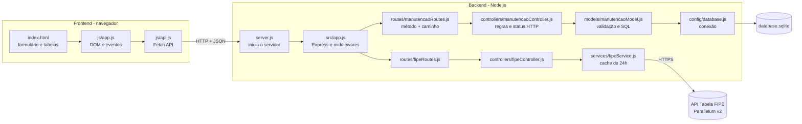

# 🔧 RevisaCar — Controle de Manutenção de Veículos

Projeto prático da **Quarta Etapa** (Desenvolvimento do CRUD) da disciplina de Programação para Internet.

O RevisaCar registra as manutenções feitas em cada veículo (troca de óleo, pneus, freios...) com
placa, quilometragem, data, custo e oficina. O veículo é escolhido pela **Tabela FIPE** (marca →
modelo → ano), e o sistema mostra quanto já foi gasto em manutenção em relação ao valor FIPE do
carro, por exemplo: _"gastos = 4,4% do valor FIPE"_.

CRUD completo (Criar, Ler, Atualizar e Excluir) com **backend em Node.js + Express + SQLite** e
**frontend em HTML, CSS e JavaScript puro**, integrado à API pública da
[Tabela FIPE (Parallelum)](https://deividfortuna.github.io/fipe/v2/).

**Equipe:** _preencher com os nomes da equipe dos seminários_

## Funcionalidades

- Cadastrar, listar, editar e excluir manutenções.
- **Validação de placa no padrão Mercosul** com regex, no backend e na tela enquanto o usuário digita.
  Se for digitada uma placa no padrão antigo (`ABC1234`), a tela mostra como ela fica no Mercosul (`ABC1C34`).
- Escolha do veículo em **selects em cascata** com dados da FIPE: tipo (carro, moto ou caminhão) → marca → modelo → ano.
- Exibição do **valor FIPE** do veículo e do **percentual dos gastos de manutenção sobre esse valor**.
- Painel **Meus veículos**: por placa, mostra quantidade de serviços, km atual, total gasto, valor FIPE e uma barra com o % do FIPE.
- Ao digitar uma placa já cadastrada, o veículo é preenchido automaticamente com os dados da última manutenção dela.
- Histórico com filtro por placa e por tipo de serviço.
- Se a FIPE estiver fora do ar, o sistema continua funcionando: a manutenção é registrada sem os dados do veículo.

## Estrutura

```
trabalho-progint-saulo-roberto/
├── backend/
│   ├── src/
│   │   ├── config/
│   │   │   └── database.js             # Conexão com o SQLite e criação da tabela
│   │   ├── controllers/
│   │   │   ├── manutencaoController.js # Regras do CRUD: decide status HTTP e resposta
│   │   │   └── fipeController.js       # Valida parâmetros e trata erros da consulta FIPE
│   │   ├── models/
│   │   │   └── manutencaoModel.js      # Representação, validação (regex da placa) e SQL
│   │   ├── routes/
│   │   │   ├── manutencaoRoutes.js     # Endpoints /api/manutencoes
│   │   │   └── fipeRoutes.js           # Endpoints /api/fipe
│   │   ├── services/
│   │   │   └── fipeService.js          # Única camada que conversa com a API externa da FIPE (com cache)
│   │   └── app.js                      # Configuração do Express e middlewares
│   ├── server.js                       # Ponto de entrada (start do servidor)
│   └── package.json
│
└── frontend/
    ├── css/
    │   └── styles.css                  # Estilização e layout (responsivo)
    ├── js/
    │   ├── api.js                      # Camada de comunicação com o backend (Fetch API)
    │   └── app.js                      # Manipulação do DOM, cascata FIPE e eventos
    └── index.html                      # Interface com formulário, painel de veículos e histórico
```

## Arquitetura em camadas



**Descrição do diagrama em texto:** a requisição nasce no navegador. O `index.html` exibe a tela;
o `app.js` do frontend reage aos eventos e chama o `api.js`, que é o único arquivo que usa `fetch`.
A requisição viaja em HTTP com JSON até o backend. O `server.js` inicia o servidor e o `app.js`
aplica os middlewares (CORS, leitura de JSON, log). Para as manutenções, o arquivo de rotas escolhe
a função do controller, o controller decide o status HTTP, o model valida os dados e executa o SQL,
e o `database.js` fornece a conexão com o SQLite. Para a FIPE, as rotas levam ao `fipeController`,
que valida os parâmetros e chama o `fipeService`, a única parte do sistema que conhece a URL da
API externa. O frontend nunca chama a FIPE diretamente.

### Responsabilidade de cada camada

| Camada | Arquivo | Sabe | Não sabe |
|---|---|---|---|
| Interface | `index.html` + `styles.css` | estrutura e aparência | de onde vêm os dados |
| Eventos | `js/app.js` | DOM, cliques, formulário, cascata de selects | URL da API, fetch |
| Comunicação | `js/api.js` | URL do backend, métodos HTTP, tratamento de erro | como a tela é desenhada |
| Entrada | `server.js` | porta do servidor | rotas e regras |
| Configuração | `src/app.js` | middlewares, ordem da requisição, erros gerais | SQL, FIPE |
| Rotas | `manutencaoRoutes.js`, `fipeRoutes.js` | qual função atende cada endpoint | como a função funciona |
| Controller | `manutencaoController.js`, `fipeController.js` | status HTTP e formato da resposta | SQL e URL da FIPE |
| Model | `manutencaoModel.js` | regras da entidade e consultas | HTTP (req/res) |
| Service | `fipeService.js` | URL da FIPE, token, cache, conversão do preço | banco de dados e HTTP do nosso servidor |
| Banco | `database.js` | como conectar e criar a tabela | regras de negócio |

## Entidade Manutenção

| Campo | Tipo | Regra |
|---|---|---|
| `id` | inteiro | gerado automaticamente |
| `placa` | texto | **padrão Mercosul**, validado com a regex `/^[A-Z]{3}[0-9][A-Z][0-9]{2}$/` (ex.: `BRA2E19`). Aceita minúsculas e hífen na entrada e grava normalizado. |
| `tipoServico` | texto | um de: Troca de óleo, Filtros, Pneus, Alinhamento e balanceamento, Freios, Suspensão, Bateria, Sistema elétrico, Arrefecimento, Revisão geral, Funilaria e pintura, Outro |
| `km` | inteiro | **inteiro positivo** (> 0) |
| `data` | texto `AAAA-MM-DD` | data real e não futura |
| `custo` | número | **maior ou igual a zero**, arredondado para centavos |
| `oficina` | texto | obrigatória, de 2 a 100 caracteres |
| `observacoes` | texto | opcional, até 500 caracteres |
| `tipoVeiculo`, `marcaCodigo`, `marca`, `modeloCodigo`, `modelo`, `anoCodigo`, `anoModelo`, `codigoFipe`, `valorFipe` | — | dados do veículo vindos da FIPE. **Opcionais, mas tudo ou nada:** se um vier, todos precisam vir. |
| `criadoEm` / `atualizadoEm` | data/hora | preenchidos pelo banco |

### Por que a regex da placa funciona

```
^[A-Z]{3}  [0-9]  [A-Z]  [0-9]{2}$
   BRA       2      E       19
```

- `^` e `$` exigem que a placa inteira siga o padrão, sem nada antes ou depois.
- `[A-Z]{3}` são as três letras, `[0-9]` um número, `[A-Z]` a letra que o Mercosul colocou no lugar
  do segundo número, e `[0-9]{2}` os dois números finais.
- Antes de validar, `normalizarPlaca()` tira espaços e hífen e passa para maiúsculas, então `bra-2e19` vira `BRA2E19`.

## Endpoints

### Manutenções (CRUD)

| Método | Rota | Corpo | Sucesso | Erros |
|---|---|---|---|---|
| GET | `/api/manutencoes` | — | 200 + lista | — |
| GET | `/api/manutencoes/:id` | — | 200 + manutenção | 400 ID inválido, 404 |
| POST | `/api/manutencoes` | `{ placa, tipoServico, km, data, custo, oficina, observacoes, ...dados FIPE }` | 201 + manutenção criada | 400 validação |
| PUT | `/api/manutencoes/:id` | igual ao POST | 200 + manutenção atualizada | 400, 404 |
| DELETE | `/api/manutencoes/:id` | — | 204 sem corpo | 400, 404 |
| GET | `/api/manutencoes/veiculos` | — | 200 + resumo por placa (total gasto, km atual, veículo e `percentualFipe`) | — |
| GET | `/api/manutencoes/opcoes` | — | 200 + `{ tiposServico, tiposVeiculo }` | — |

A listagem aceita filtros opcionais: `?placa=BRA2&tipoServico=Freios`.

### Tabela FIPE (repassa para a API externa)

`:tipo` pode ser `carros`, `motos` ou `caminhoes`.

| Método | Rota | Resposta |
|---|---|---|
| GET | `/api/fipe/:tipo/marcas` | `[{ codigo, nome }]` |
| GET | `/api/fipe/:tipo/marcas/:marca/modelos` | `[{ codigo, nome }]` |
| GET | `/api/fipe/:tipo/marcas/:marca/modelos/:modelo/anos` | `[{ codigo, nome }]` (o ano `32000` da FIPE aparece como "Zero km") |
| GET | `/api/fipe/:tipo/marcas/:marca/modelos/:modelo/anos/:ano` | `{ marca, modelo, anoModelo, combustivel, codigoFipe, preco, valor, mesReferencia }` |

Erros: 400 para parâmetros inválidos, 404 se o veículo não existir na FIPE, 502 se a FIPE estiver
fora do ar e 503 se o limite diário de consultas acabar.

Todos os erros seguem o formato `{ "erro": "mensagem" }`.

## Integração com a Tabela FIPE

- **API usada:** [FIPE API v2 da Parallelum](https://deividfortuna.github.io/fipe/v2/), gratuita, com licença MIT e sem cadastro.
  URL base: `https://fipe.parallelum.com.br/api/v2`.
- **Consulta em cascata:** marcas → modelos da marca → anos do modelo → preço e detalhes.
- **Limite:** 500 requisições por dia sem token, ou 1.000 com um token gratuito criado em
  [fipe.api.br](https://fipe.api.br/register).
- **Cache:** o `fipeService.js` guarda cada resposta em memória por 24 horas (a tabela só muda uma vez
  por mês). Assim a lista de marcas, por exemplo, é buscada na FIPE uma única vez por dia.
- **Isolamento:** só o `fipeService.js` conhece a URL da FIPE. Se um dia for preciso trocar de
  provedor, muda só esse arquivo.
- **Valor guardado:** ao registrar a manutenção, o valor FIPE do momento é salvo junto (`valorFipe`).
  O percentual "gastos x FIPE" usa o veículo da manutenção mais recente da placa.

## Fluxo de uma operação: registrar uma manutenção

1. O usuário digita a placa. A cada tecla, `app.js` normaliza o texto e testa a regex, mostrando "✓ Placa válida" ou o erro.
2. Escolhe a marca. `app.js` chama `api.fipe.modelos()`, que faz `GET /api/fipe/carros/marcas/21/modelos`.
3. No backend, `fipeRoutes.js` → `fipeController.modelos` valida os parâmetros → `fipeService.modelos()`
   consulta a FIPE (ou o cache) e devolve `{ codigo, nome }`. O mesmo acontece para os anos.
4. Ao escolher o ano, a tela busca o valor e mostra "Valor FIPE: R$ 21.432,00".
5. O usuário preenche serviço, km, data, custo e oficina e clica em **Registrar manutenção**.
6. `api.js` faz `POST /api/manutencoes` com o JSON no corpo.
7. `manutencaoRoutes.js` direciona para `manutencaoController.criar`, que chama `normalizar()` e `validar()` do model.
   Se a placa não passar na regex, ou o km não for inteiro positivo, ou o custo for negativo, responde **400**.
8. O model executa o `INSERT` pelo `database.js` e o controller responde **201**.
9. `app.js` mostra "Manutenção registrada com sucesso", limpa o formulário e recarrega o painel de veículos e o histórico.

## Como rodar

Requisito: [Node.js](https://nodejs.org) 18 ou superior (recomendado: versão LTS).

```bash
cd backend
npm install
npm start          # ou: npm run dev (reinicia sozinho ao salvar)
```

Abra **http://localhost:3000**. O backend também serve o frontend, então tudo roda com um comando.
Se preferir abrir o frontend com o Live Server do VS Code, funciona igual: o CORS já está liberado
e o `api.js` aponta automaticamente para `http://localhost:3000`.

O banco `database.sqlite` é criado automaticamente na pasta `backend/` na primeira execução.
A consulta à FIPE precisa de internet.

### Variáveis de ambiente (opcionais)

| Variável | Para que serve | Padrão |
|---|---|---|
| `PORT` | porta do servidor | `3000` |
| `FIPE_TOKEN` | token gratuito da FIPE para subir o limite para 1.000 consultas por dia | sem token |
| `DB_PATH` | caminho do arquivo do banco | `backend/database.sqlite` |

Exemplo no Windows (cmd): `set FIPE_TOKEN=seu_token && npm start`. No Linux ou macOS: `FIPE_TOKEN=seu_token npm start`.

## Testando a API sem o frontend

```bash
# Tabela FIPE
curl http://localhost:3000/api/fipe/carros/marcas
curl http://localhost:3000/api/fipe/carros/marcas/21/modelos

# CRUD
curl http://localhost:3000/api/manutencoes
curl -X POST http://localhost:3000/api/manutencoes -H "Content-Type: application/json" \
     -d '{"placa":"BRA2E19","tipoServico":"Troca de óleo","km":45200,"data":"2026-09-10","custo":289.90,"oficina":"Auto Center Silva"}'
curl -X PUT http://localhost:3000/api/manutencoes/1 -H "Content-Type: application/json" \
     -d '{"placa":"BRA2E19","tipoServico":"Troca de óleo","km":45200,"data":"2026-09-10","custo":300,"oficina":"Auto Center Silva"}'
curl http://localhost:3000/api/manutencoes/veiculos
curl -X DELETE http://localhost:3000/api/manutencoes/1

# Placa no padrão antigo: deve responder 400
curl -X POST http://localhost:3000/api/manutencoes -H "Content-Type: application/json" \
     -d '{"placa":"ABC1234","tipoServico":"Pneus","km":1000,"data":"2026-10-01","custo":0,"oficina":"Teste"}'
```

Também dá para usar extensões como Thunder Client (VS Code), Insomnia ou Postman.

## Acessibilidade

- Todos os campos têm `<label>`, e os grupos "Veículo" e "Serviço" usam `fieldset` e `legend`.
- As tabelas têm `caption` e cabeçalhos com `scope`.
- Mensagens de sucesso, erro e o quadro da FIPE ficam em regiões `aria-live`, anunciadas pelos leitores de tela.
- Placa inválida recebe `aria-invalid` e a dica fica ligada ao campo por `aria-describedby`.
- Os botões Editar e Excluir têm rótulo completo, por exemplo "Excluir Troca de óleo da placa BRA2E19 em 10/09/2026".
- Foco visível em todos os controles e layout responsivo para celular.

## Segurança

- Consultas SQL com parâmetros (`?` e `@nome`), evitando SQL injection.
- Dados exibidos com `textContent`, nunca com `innerHTML` de dados do usuário, evitando XSS.
- Os parâmetros das rotas da FIPE são validados (`/^\d+$/` e `/^\d+-\d+$/`) antes de entrar na URL da API externa.
- Validação completa no backend (o frontend não é confiável).

## Próximos passos sugeridos

1. Alertas de próxima manutenção (por exemplo, troca de óleo a cada 10.000 km).
2. Validar que o km não diminui em relação às manutenções anteriores da mesma placa.
3. Gráfico de gastos por mês e por tipo de serviço.
4. Testes automatizados da API com `node:test` e `supertest`.
5. Autenticação com JWT para cada usuário ter a própria frota.
